# FitHub database design

## Scope

Stage 2 established the PostgreSQL schema, Entity Framework Core mappings, ASP.NET Core Identity store, development seed process, and initial migration. Stage 3 adds persisted, hashed refresh-token records for authentication; membership and other business workflows remain outside this scope.

All application tables use UUID primary keys and UTC `timestamp with time zone` audit fields named `CreatedAt` and `UpdatedAt`. Controlled lifecycle values are stored as bounded strings from C# enums. Monetary and measurement values use fixed-precision PostgreSQL `numeric` columns.

## Entity relationships

```mermaid
erDiagram
    ApplicationUser ||--o{ Membership : owns
    MembershipPlan ||--o{ Membership : defines
    ApplicationUser ||--o{ Payment : makes
    Membership o|--o{ Payment : funds
    ApplicationUser ||--o{ Attendance : records
    ApplicationUser o|--o{ WorkoutTemplate : owns
    WorkoutTemplate }o--o{ Exercise : contains
    ApplicationUser ||--o{ WorkoutSession : performs
    WorkoutTemplate o|--o{ WorkoutSession : instantiates
    WorkoutSession ||--o{ ExerciseLog : contains
    Exercise ||--o{ ExerciseLog : identifies
    ExerciseLog ||--o{ SetLog : contains
    ApplicationUser ||--o{ BodyMeasurement : records
    Equipment ||--o{ EquipmentStatusEvent : history
    ApplicationUser o|--o{ EquipmentStatusEvent : changes
    Equipment ||--o{ FaultReport : receives
    ApplicationUser ||--o{ FaultReport : reports
    FaultReport ||--o{ FaultReportImage : references
    Equipment ||--o{ MaintenanceAction : receives
    FaultReport o|--o{ MaintenanceAction : resolves
    ApplicationUser o|--o{ MaintenanceAction : performs
    ParkingSpace ||--o{ ParkingStatusEvent : history
    ApplicationUser o|--o{ ParkingStatusEvent : changes
    ApplicationUser o|--o{ ClassSchedule : instructs
    ClassSchedule ||--o{ ClassBooking : receives
    ApplicationUser ||--o{ ClassBooking : makes
    ApplicationUser ||--o{ Notification : receives
    ApplicationUser ||--o{ Recommendation : receives
    ApplicationUser o|--o{ AuditLog : acts
    ApplicationUser ||--o{ RefreshToken : owns
    ApplicationUser ||--o{ AttendanceCheckInToken : receives
    MembershipPlan ||--o{ Payment : prices
    WorkoutTemplate ||--o{ WorkoutPlanAssignment : assigned
    ApplicationUser ||--o{ WorkoutPlanAssignment : member
```



ASP.NET Core Identity also creates role, claim, login, token, and user-role tables around `ApplicationUser`. `WorkoutTemplateExercises` is the EF-managed many-to-many join table between workout templates and exercises.

## Aggregate and table notes

| Area | Tables | Important constraints and indexes |
|---|---|---|
| Identity | `AspNetUsers`, `RefreshTokens`, and standard Identity tables | Unique normalized username, Identity email index, active-user and onboarding indexes; UUID user and role keys; bounded profile measurements; unique SHA-256 refresh-token hash and user/expiry index. |
| Membership | `MembershipPlans`, `Memberships`, `Payments`, `ProcessedPaymentWebhooks` | Unique plan name; membership user/status and expiry indexes; `numeric(12,2)` authoritative prices/refunds; Checkout Session, PaymentIntent, and Stripe event IDs are unique. Development seed payments are explicitly marked and excluded from revenue. |
| Attendance | `Attendances`, `AttendanceCheckInTokens` | User/check-in history indexes; unique SHA-256 token hashes, expiry index, and `xmin` replay concurrency protection. |
| Workouts | `Exercises`, `WorkoutTemplates`, `WorkoutTemplateExercises`, `WorkoutPlanAssignments`, `WorkoutSessions`, `ExerciseLogs`, `SetLogs` | Unique exercise name; searchable muscle group/equipment indexes; trainer/member assignment indexes; unique exercise order per session; unique set number per exercise log; weights use `numeric(8,2)`. |
| Progress | `BodyMeasurements` | User/recorded-time index; height, weight, body-fat percentage, and circumference values use bounded fixed precision. |
| Equipment | `Equipment`, `EquipmentStatusEvents`, `FaultReports`, `FaultReportImages`, `MaintenanceActions` | Unique equipment code; current-state index; chronological status history; fault status/priority indexes; cost uses `numeric(12,2)`. |
| Parking | `ParkingSpaces`, `ParkingStatusEvents` | Unique space code; zone/current-state index; chronological history index. |
| Classes | `ClassSchedules`, `ClassBookings` | Positive-capacity and valid-time-range database checks; approval-status/start and trainer indexes; bounded location/review reason; one booking per user and schedule. |
| Communication | `Notifications`, `Recommendations` | User/read/status and expiry indexes. |
| Auditing | `AuditLogs` | Occurrence-time, user, and entity lookup indexes. |

## Status history and concurrency

`Equipment.CurrentState` is the current snapshot and `EquipmentStatusEvents` is the append-only state history. Allowed equipment states are `Available`, `Occupied`, `SharingAllowed`, `Maintenance`, and `Offline`.

Equipment updates use PostgreSQL's system `xmin` value as an EF Core row-version concurrency token. Competing writers therefore receive `DbUpdateConcurrencyException` instead of silently overwriting a newer state.

`ParkingSpaces.CurrentState` is likewise separate from chronological `ParkingStatusEvents`. Parking states are `Available`, `Occupied`, `Reserved`, and `OutOfService`.

## Image storage

`FaultReportImages` stores only a bounded `ImageUrl` path or URL and an optional caption. Image binary content is intentionally kept outside PostgreSQL and must later be stored in an approved object/file store.

## Development seeding

Development seeding is an idempotent startup process enabled with `SeedData:Enabled=true`. It creates:

- `Member`, `Trainer`, and `Administrator` roles;
- one demonstration user for each staff role, a general Member, and idempotent **Member – No Membership** / **Member – Active Membership** scenarios;
- monthly and annual membership plans;
- representative exercises;
- equipment in cardio and strength zones;
- representative parking spaces.

The demo password is read from `SeedData:DemoPassword` (environment variable `SeedData__DemoPassword`). No password hash or plaintext password is stored in source code or the migration. The seed process runs only when the ASP.NET Core environment is `Development` and explicit seeding is enabled.

## Migration

The latest database migration is `AddRoleWorkflowsAndOnboarding`; it follows the existing Stage 1–8 foundation migrations. Apply all pending migrations with:

```powershell
dotnet tool restore --tool-manifest backend/.config/dotnet-tools.json
dotnet tool run dotnet-ef -- database update --project backend/src/FitHub.Infrastructure --startup-project backend/src/FitHub.Api
```
## Stage 6 smart equipment additions

`Equipment` now holds current state, owner, optional single partner, last presence reading, clearance grace start, the pre-offline state and PostgreSQL `xmin` concurrency version. `EquipmentStatusEvent` is the append-only history with previous/resulting state and event type. `EquipmentDevice` is one-to-one with equipment and stores device code, PBKDF2 credential hash, connection flag and heartbeat time. `MemberAccessCard` stores only an HMAC hash of a simulated card UID.

`FaultReport` uses controlled category/status values, serious-safety flag, maintenance notes and resolution date. `FaultReportImage` stores a URL only. Existing title/description/caption columns are retained for migration compatibility; no existing report data is dropped.

## Stage 7 parking and recommendation additions

`ParkingSpace` stores its latest state, confidence, source and event time. `ParkingStatusEvent` is the append-only detection/correction history. `ParkingCamera` stores a unique camera code and PBKDF2 credential hash. Legacy Reserved values migrate to Unknown and OutOfService values migrate to Disabled.

`ApplicationUser` stores controlled fitness-goal and activity-level preferences. It also stores the Member onboarding profile: preferred name, date of birth, height, weight, and completion flag. `Recommendation` stores `RuleCode` and `Reason` alongside its content; old rows receive explicit legacy provenance rather than losing data.

## Stage 8 booking and notification additions

Class schedules retain the instructor foreign key and positive-capacity/time constraints and add location, approval status, reviewer, review time, and review reason. Existing schedules migrate as Approved; new and edited schedules enter PendingApproval. Class bookings retain the unique class/user key, allowing a cancelled row to be reactivated without duplicates. Capacity decisions use a PostgreSQL row lock on the schedule.

Payments now store the Stripe PaymentIntent identifier, cumulative refunded amount/time, and an explicit development-seed marker. Revenue uses confirmed gross less confirmed refunds and never includes seed demonstration payments.

Notifications now have a controlled type and a unique per-user deduplication key. Existing rows receive a `legacy:{notification UUID}` key during migration so the new unique index does not discard data.
